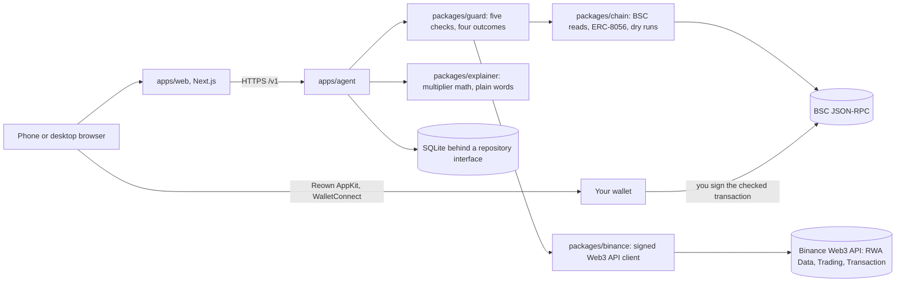
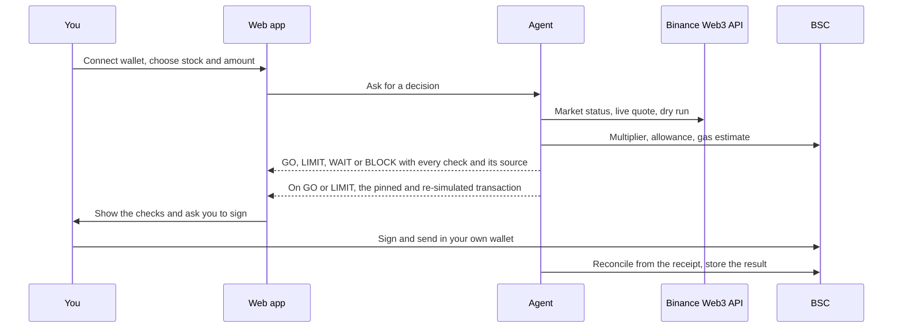

# Bitstock

**Buy tokenized stocks on BNB Smart Chain, only after the checks pass.**

   

Bitstock is a market-aware assistant for small-money investing in tokenized stocks. Before every buy it reads the market session, the token's share multiplier, an independent stock price, the price impact of your exact amount, and a dry run of the real transaction. It shows you each result with its source and time, decides **Go**, **Go with a tighter limit**, **Wait** or **Do not buy now**, and only then lets you sign a small buy in your own wallet. Afterwards it explains, in plain words, what you hold.

Built for BNB Hack: Tokenized Stocks Edition. BSC mainnet only. Spot only. Not investment advice.

| | |
|---|---|
| **Web app** | https://trybitstock.xyz |
| **Agent API** | https://agent-production-6403.up.railway.app/healthz (Railway, Singapore) |
| **Try it** | Open https://trybitstock.xyz on a phone. The live check and the explanations need no wallet. To buy, connect any WalletConnect wallet on BNB Smart Chain; it needs a little USDT. |

[Proof on BSC mainnet](#proof-on-bsc-mainnet) · [What it does](#what-it-does) · [Architecture](#architecture) · [Status](#status) · [Judging criteria](#how-it-maps-to-the-judging-criteria) · [Risk controls](#risk-controls) · [Binance APIs used](#binance-web3-api-endpoints-used) · [Run it](#run-it) · [Limits](#limits)

<p>
  
  
  
</p>

## Live figures

Read on 17 Oct 2026 from the live agent's [`/healthz`](https://agent-production-6403.up.railway.app/healthz) and from the repository. These are counts of things that happened, not claims about returns.

| | |
|---|---|
| Guard decisions recorded by the live agent | 27: 15 LIMIT, 12 BLOCK (stored on the agent's volume, so they survive restarts) |
| Real buys on BSC mainnet | 1 (see below) |
| Free first slices claimed | 10 of 10, every transfer confirmed on chain, network fee paid by Bitstock (see below) |
| Tests | 221 passing, 83 of them in the guard |
| Binance Web3 API endpoints used | 8 (listed below), called from Singapore |

## Proof on BSC mainnet

Every row is a real transaction or a real recorded response. Nothing here is simulated or sample data.

| What | Evidence |
|---|---|
| A real protected buy: 1 USDT bought **0.004333697515150079 NVDAB**, signed by the owner in their own wallet after the guard said LIMIT and the exact transaction passed its dry run. Gas used 939,279; fee 0.0000490773 BNB. | [0x526643d7…e8c1](https://bscscan.com/tx/0x526643d73ed93ad2a90033397710d4d03d41d6835938e722ba647b408666e8c1) (block 126,905,587, 10 Oct 2026 22:12 UTC) · [`docs/evidence/mode-a-buy-1usd.json`](docs/evidence/mode-a-buy-1usd.json) |
| The owner's USDT approval for the swap contract, capped at 2 USDT | [0x1a500450…d8be](https://bscscan.com/tx/0x1a500450deba945ebc1d2207d702e7db791293a424499213a4c78d7e7fd4d8be) |
| A guard decision on a Saturday, with the US market closed: LIMIT, with a slippage limit tightened from 0.5% to about 0.1% | [`docs/evidence/guard-nvdab-1usd-after-approval.railway-sg.json`](docs/evidence/guard-nvdab-1usd-after-approval.railway-sg.json) |
| The guard refusing to proceed before the approval existed: BLOCK, "approve first" | [`docs/evidence/guard-nvdab-1usd.railway-sg.json`](docs/evidence/guard-nvdab-1usd.railway-sg.json) |
| Signed Binance Web3 API calls from an allowed region, and the same call refused from a US connection (`40304`) | [`docs/evidence/`](docs/evidence/) · [`docs/VERIFIED.md`](docs/VERIFIED.md) section 3a |
| Live on-chain reads of NVDAB's ERC-8056 multiplier | [`docs/evidence/07-onchain-nvdab.json`](docs/evidence/07-onchain-nvdab.json) |
| The free first slice: 1 USDT swapped into NVDAB, split into ten boxes committed in advance, and all ten claimed on 11 Oct 2026 by wallets that paid no network fee. The relayer paid 100,903 to 105,703 gas per transfer, 0.0000050452 to 0.0000052852 BNB each, 0.0000526091 BNB in all. | [funding swap](https://bscscan.com/tx/0x8513376541801cfa8a8f24c71aaac198e03df19735c863c45877b784b0ca0170) · [box 1](https://bscscan.com/tx/0x707b2d925f2d27c052aeb18e9d588a7e60b31811e333f1c4788ffebbdd3572c1) · [box 10](https://bscscan.com/tx/0xe9c220e1ab3db4f6254350ae6824ed223c5433c14d7a02d372b27922811549f8) · [`docs/evidence/gift-claims-2026-10-11.railway-sg.json`](docs/evidence/gift-claims-2026-10-11.railway-sg.json) (all ten) |
| A new wallet's first step: the agent prepares and tests a USDT approval for exactly the buy amount, to the spender both Binance answers agree on (rules version 2 live) | [`docs/evidence/approval-and-rules-v2-nvdab-1usd.railway-sg.json`](docs/evidence/approval-and-rules-v2-nvdab-1usd.railway-sg.json) |
| The claim page refusing a request from the United States with HTTP 451 | Tested on the Vercel deployment from a US connection; see [`docs/screenshots/phone-claim-dark.jpg`](docs/screenshots/phone-claim-dark.jpg) |

## Architecture



One protected buy, end to end:



## What it does

| | |
|---|---|
| **Check** | Five checks on live data before every buy: market session (Binance RWA Data), share multiplier (the token contract, ERC-8056 `uiMultiplier()`), an independent stock price (compared per share through the multiplier), price impact and route for your exact amount (only routes that can be dry-run), and a Transaction API dry run that must show the stock arriving in your wallet. |
| **Decide** | GO when everything passes; LIMIT when there are warnings, with a tighter slippage limit chosen by a written rule; WAIT when something cannot be read, re-checked later from scratch; BLOCK on any failure, with one sentence why. Missing data never becomes a guess. |
| **Buy** | The swap is rebuilt from the exact quote that was checked, pinned to the contract the quote named, dry-run again, and given a gas limit from the node's estimate. You sign it in your own wallet. Bitstock never holds keys. Phones connect through Reown AppKit (WalletConnect), limited to BNB Smart Chain. |
| **Explain** | Your tokens shown as shares, and what changes them. Bitstock says "dividend" only when the implied amount matches the company's announcement and every input is confirmed; otherwise it says "multiplier change" and lists what is and is not known. |

## Status

| Part | Status |
|---|---|
| Signed Binance Web3 API client (RWA Data, Trading, Transaction) | Built, used live |
| Guard: five checks, four outcomes, stored decision records, written method | Built, used live |
| Protected buy (Mode A): decision API, prepared and re-simulated transaction, signed in the web app | Built; one real buy on mainnet. A new wallet approves exactly the buy's USDT from the Buy page (prepared and tested live on 17 Oct 2026; not yet signed by a user) |
| Chain package: unit conversions, EIP-155 signing, ERC-20 transfer with dry run, multiplier events | Built, tested |
| Explainer and multiplier sentry | Built; the sentry records snapshots on the server |
| Web app: home, live check, buy, holdings, learn, about, claim notice | Built, deployed at https://trybitstock.xyz |
| Wallet connection through Reown AppKit (WalletConnect), BNB Smart Chain only | Built, deployed; the wallet list and the relay pairing were checked in a 360 px browser; a full connect and send from a phone is not yet recorded here |
| Restricted-jurisdiction block on the claim page | Built, tested from a US connection |
| Free first slice ($1 in ten boxes, network fee paid for the recipient) | Funded ([funding swap](https://bscscan.com/tx/0x8513376541801cfa8a8f24c71aaac198e03df19735c863c45877b784b0ca0170), block 126,966,466); all ten boxes claimed and confirmed on 11 Oct 2026. The draw is revealed after the gift closes on 18 Oct 2026 |
| Checked buys through the user's own Binance Agentic Wallet (wallet skill, Mode B) | Built; first real swap not yet made. It runs inside the limits the user sets in the Binance App, and the team demonstrates it with its own wallet |
| Agent on BNB Agent Studio | Built, hosted, registered on-chain (ERC-8004 agent 370988) |

## How it maps to the judging criteria

| Criterion | What to look at |
|---|---|
| Technical implementation | A deterministic guard with 79 tests (198 across the repository), contract tests replaying recorded live responses, bigint money math with property tests, EIP-155 signing checked against the specification's test vector, a real buy whose prepared transaction is pinned and re-simulated, SQLite storage with idempotency keys, a persistent kill switch and reconciliation from receipts. |
| Creativity | The guard treats a weekend as a real condition: tokenized stocks trade on chain while Wall Street is shut, so it compares with the last close and only allows a tighter limit, instead of either blocking or ignoring it. |
| Developer experience | A timestamped friction log with evidence for each line: [`docs/DX_EVIDENCE.md`](docs/DX_EVIDENCE.md). The report itself is written by the owner. |
| Product quality | Phone-first, light and dark, keyboard and reduced-motion friendly. Lighthouse (mobile) on the Vercel deployment: performance 97 to 99, accessibility 100, best practices 100. |

## Risk controls

| Control | Default | Where |
|---|---|---|
| Price impact | warn above 0.3%, refuse above 1% | `packages/guard/src/config.ts` |
| Independent price gap | live price: pass within 0.5%, refuse above 2%; last close: never a pass, refuse above 10% | same |
| Slippage | 0.5% on GO; on LIMIT, twice the quoted impact plus 0.10%, kept between 0.10% and 0.25% | same, explained in [`docs/METHOD.md`](docs/METHOD.md) |
| Multiplier change | warn when one is scheduled within 24 hours | same |
| Routes | quote-on-request (RFQ) routes refused because they cannot be dry-run | `packages/guard/src/rules.ts` |
| Swap destination | refused unless it goes to the contract the quote named, from the buyer, with no BNB attached | same |
| Largest buy | $250 by default, why in [`docs/METHOD.md`](docs/METHOD.md) | `BUY_MAX_USD` |
| Kill switch | environment flag or authenticated admin call; survives restarts; cleared only with an explicit phrase | `apps/agent/src/killswitch.ts` |
| Rate limits | 10 checks per minute per client | `RATE_LIMIT_PER_MINUTE` |

The defaults are conservative starting values, not measured ones; `docs/METHOD.md` says so and how they will be revised.

## Binance Web3 API endpoints used

| Module | Endpoint | Purpose |
|---|---|---|
| RWA Data | `GET /api/v1/dex/market/rwa/tokens` | Token list, price, market status |
| RWA Data | `GET /api/v1/dex/market/rwa/underlying-market` | Market status (`statusInfo`) and market data |
| RWA Data | `GET /api/v1/dex/market/rwa/underlying-profile` | Ticker and company note |
| RWA Data | `GET /api/v1/dex/market/rwa/price` | Probed and recorded |
| Trading | `GET /api/v1/dex/aggregator/quote` | Live quote at the exact size |
| Trading | `GET /api/v1/dex/aggregator/swap` | The transaction to dry-run and sign |
| Trading | `GET /api/v1/dex/aggregator/approve-transaction` | Confirms the spender before Bitstock prepares a USDT approval |
| Transaction | `POST /api/v1/dex/pre-transaction/simulate` | Dry run of every swap |

Also used: BNB Smart Chain JSON-RPC (multiplier, allowance, balances, gas estimates, receipts) and Yahoo Finance's chart API as the independent stock price (Pyth Pro is tried first when its key is entitled to US equities; see [`docs/VERIFIED.md`](docs/VERIFIED.md) section 6a).

## Run it

Requires Node 22.18 or later, pnpm, a Binance Web3 API key, and a server in a region the Binance Web3 API allows.

```bash
cp .env.example .env              # fill in values; never commit .env
pnpm install
pnpm lint && pnpm typecheck && pnpm test && pnpm build
PORT=8080 PUBLIC_WEB_ORIGIN=http://localhost:3000 node apps/agent/src/server.ts   # agent API on :8080
NEXT_PUBLIC_AGENT_URL=http://localhost:8080 NEXT_PUBLIC_REOWN_PROJECT_ID=<your Reown project ID> pnpm --filter @bitstock/web dev   # web app on :3000
```

## Repository

```text
apps/agent       decision API, intent queue, gift relayer, sentry, admin
apps/web         the web app (Next.js)
packages/binance signed Web3 API client and by-shape finders
packages/guard   the five checks, the outcome rule, decision records
packages/chain   unit conversions, signing, ERC-20, multiplier events
packages/explainer multiplier math and plain-language text
docs/            architecture, decisions, method, verified facts, evidence
```

| | |
|---|---|
| `AGENTS.md` | Engineering manual and hard rules |
| `docs/ARCHITECTURE.md` | How the system is built and why |
| `docs/adr/` | Architecture decisions |
| `docs/METHOD.md` | How the guard decides, with every default and its reason |
| `docs/VERIFIED.md` | Facts checked live, with evidence |
| `docs/DX_EVIDENCE.md` | Developer-experience evidence log |
| `docs/ROADMAP.md` | What exists, what is next, what is not planned |

## Limits

- Tokenized stocks can be paused or blocked by their issuer. Bitstock explains this and does not work around it.
- The independent price comes from an unofficial endpoint without a service guarantee; when it cannot be read, the check is a warning and never a pass.
- Multiplier history starts when the sentry began recording; older multiplier events could not be read with free RPC endpoints.
- Wallet connection uses Reown's hosted relay and wallet list. If Reown cannot be reached, wallets cannot connect, and without `NEXT_PUBLIC_REOWN_PROJECT_ID` the app says so and does not try.
- Bitstock does not promise profit or protect against loss. It removes avoidable mistakes, not market risk.

## Security

See `SECURITY.md`.

## Licence

MIT
